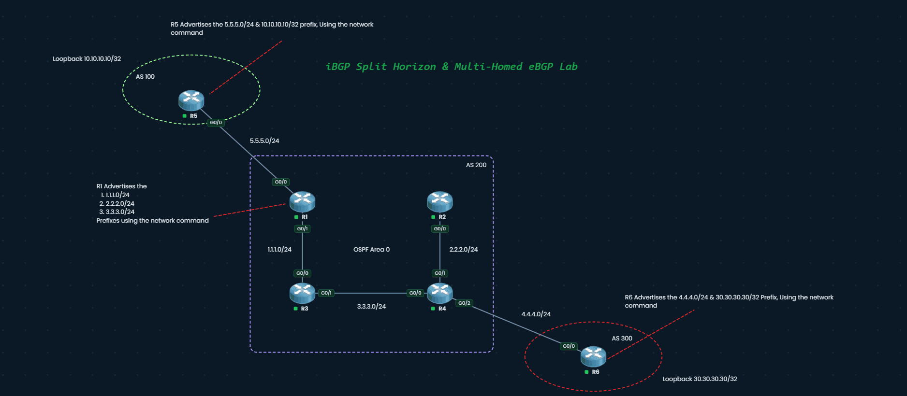
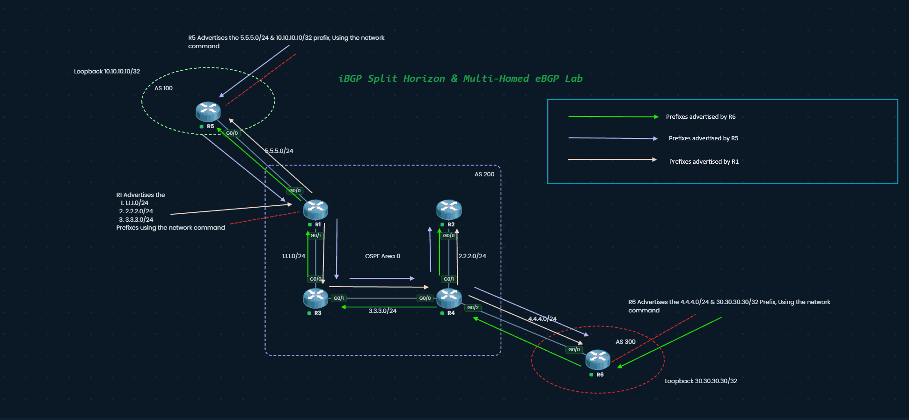
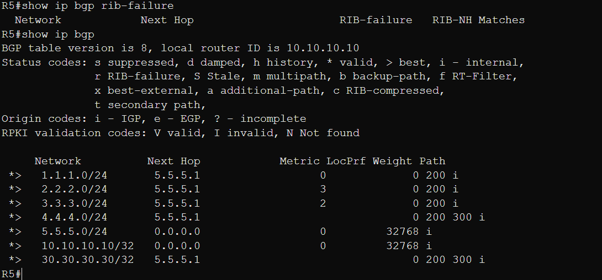
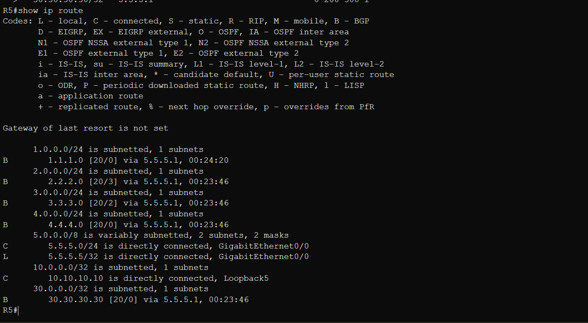
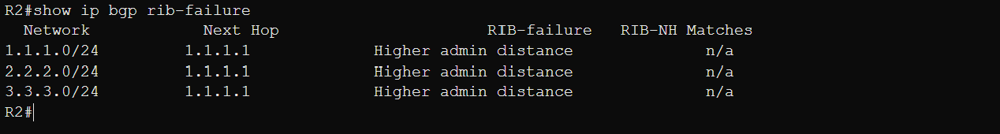
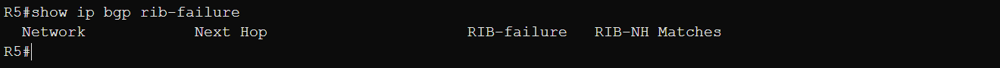

# iBGP Split Horizon & Multi-Homed eBGP Lab

### Sandbox Source - https://pingmynetwork.com/ 
### About the sandbox - Extremely fast, Easy to replicate labs from OCG or other learning materials, has great learning material.

**CCNP ENARSI (300-410):** 1.11 Troubleshoot BGP (Internal and External)

A transit AS (AS 200) sits between two customer ASes. The lab shows three things:

1. The iBGP next-hop problem, and how `next-hop-self` fixes it
2. iBGP split horizon, and why AS 200 needs a full mesh
3. How to read `show ip bgp rib-failure`, and why some routes RIB-fail while others never can

## Topology

| AS | Routers | Role |
|----|---------|------|
| 100 | R5 | Originates 5.5.5.0/24 and 10.10.10.10/32 (Loopback5) |
| 200 | R1, R2, R3, R4 | Transit AS. OSPF Area 0 as IGP, full-mesh iBGP |
| 300 | R6 | Originates 4.4.4.0/24 and 30.30.30.30/32 (loopback) |

| Link | Subnet |
|------|--------|
| R5 G0/0 – R1 G0/0 (eBGP) | 5.5.5.0/24 |
| R1 G0/1 – R3 G0/0 | 1.1.1.0/24 |
| R3 G0/1 – R4 G0/0 | 3.3.3.0/24 |
| R2 G0/0 – R4 G0/1 | 2.2.2.0/24 |
| R4 G0/2 – R6 G0/0 (eBGP) | 4.4.4.0/24 |

- OSPF runs only on AS 200's internal links. 5.5.5.0/24 and 4.4.4.0/24 are **not** in OSPF.
- R1 also originates 1.1.1.0/24, 2.2.2.0/24, and 3.3.3.0/24 into BGP so AS 100 and AS 300 can reach AS 200's internal networks.
- iBGP sessions use physical interface addresses. This is fine for a lab; production designs peer between loopbacks with `update-source`.

Full configs are in [configs.md](configs.md).

### Prefix advertisement flow

| Color | Prefixes | Origin |
|-------|----------|--------|
| Green | 4.4.4.0/24, 30.30.30.30/32 | R6 (AS 300) |
| Purple | 5.5.5.0/24, 10.10.10.10/32 | R5 (AS 100) |
| Peach | 1.1.1.0/24, 2.2.2.0/24, 3.3.3.0/24 | R1 (AS 200) |

The arrows follow the physical links each prefix crosses on its way through the topology. The BGP updates themselves ride inside TCP sessions between peers. For example, R1's update to R2 is carried over the R1–R2 iBGP session, which OSPF routes through R3 and R4. R3 forwards those packets, but it doesn't re-advertise the route to R2 in BGP. That's split horizon (section 2).

## 1. How the `network` command works

In BGP, `network` does not enable BGP on an interface. It tells BGP to originate a prefix **only if an exact match (prefix and mask) already exists in the RIB**, from any source: connected, static, or an IGP.

Once it matches, the prefix goes into the local BGP table with next hop `0.0.0.0`, weight `32768`, and origin `i`. It then goes through best-path selection and is advertised to peers.

The IGP metric is carried as the MED. In R5's table, 2.2.2.0/24 has metric `3` and 3.3.3.0/24 has metric `2`. Those are R1's OSPF costs to those networks. 1.1.1.0/24 is connected on R1, so its MED is `0`.

## 2. iBGP split horizon

- **eBGP** prevents loops with AS_PATH: a router drops any route containing its own AS.
- **iBGP** can't use AS_PATH, because the AS number isn't added inside one AS. Instead it uses split horizon: **a route learned from an iBGP peer is never advertised to another iBGP peer.** It can still go to eBGP peers.

The consequence is that every AS 200 router must peer directly with the edge router that learned the route. R1 sends 10.10.10.10/32 to R2, R3, and R4, but R3 will never relay it to R2. That's why AS 200 runs a full mesh: 4 routers × 3 / 2 = 6 sessions. Route reflectors and confederations are the scalable alternatives.

Split horizon decides *whether* a peer gets the route. The next hop decides whether the peer can *use* it. That's the next section.

## 3. The problem: iBGP without `next-hop-self`

When a router passes an eBGP-learned route to an iBGP peer, it **keeps the original NEXT_HOP** by default. R1 advertised 10.10.10.10/32 to its iBGP peers with next hop `5.5.5.5` (R5).

| Router | Next hop 5.5.5.5 reachable? | Result |
|--------|------------------------------|--------|
| R1 | Yes, via connected 5.5.5.0/24 | Valid and best (`*>`), installed as `B` with AD 20 |
| R2, R3, R4 | No. 5.5.5.0/24 isn't in OSPF | In the BGP table but **inaccessible**. Not best, not installed |

A route is in the BGP table whether or not its next hop resolves. Next-hop reachability only decides whether it can be **best** and get **installed in the RIB**.

The same thing happens in the other direction. R6's prefixes reach R1, R2, and R3 with next hop `4.4.4.6`, which OSPF doesn't know either.

**Two fixes:**

1. `neighbor x.x.x.x next-hop-self` on the eBGP edge routers (R1 and R4) toward their iBGP peers. This is the fix used in this lab.
2. Advertise the external link subnets (5.5.5.0/24 and 4.4.4.0/24) into OSPF, typically as passive interfaces.

## 4. The fix: `next-hop-self`

Configured per neighbor, on R1 and R4 only. R2 and R3 have no eBGP peers, so they don't need it.

- R1 now advertises AS 100 prefixes with next hop `1.1.1.1` (its iBGP source address).
- R4 now advertises AS 300 prefixes with its own address.
- R2 and R3 resolve those next hops through OSPF, so the paths become `*>` and get installed as `B` with AD 200.

After changing it, refresh with `clear ip bgp * soft out`.

AS 200 now provides transit end to end. R5 learns AS 300's prefixes through AS 200, with AS_PATH `200 300`:

## 5. RIB failures

A **RIB-failure** means BGP's best path was offered to the RIB but not installed, almost always because the RIB already has that prefix from a **lower-AD source**. It's shown as `r>` in `show ip bgp`.

It's mostly cosmetic: the route is still BGP's best path and is still advertised to peers, unless `bgp suppress-inactive` is configured.

AD reference: connected 0, static 1, eBGP 20, OSPF 110, iBGP 200.

### R1: eBGP vs connected

R1 learns 5.5.5.0/24 from R5 via eBGP (AD 20), but it's directly connected on G0/0 (AD 0). The connected route wins, so 5.5.5.0/24 RIB-fails. R4 shows the same thing for 4.4.4.0/24.

### R2: iBGP vs OSPF and connected

R2 learns 1.1.1.0/24, 2.2.2.0/24, and 3.3.3.0/24 from R1 via iBGP (AD 200). It already has them from OSPF (AD 110), and 2.2.2.0/24 is connected (AD 0). All three RIB-fail with `Higher admin distance`.

The next hop `1.1.1.1` also confirms that R1's `next-hop-self` is working. R3 and R4 show the same pattern.

### R5: why locally originated prefixes never RIB-fail

R5's own 5.5.5.0/24 and 10.10.10.10/32 show `*>` with no `r` flag, and its rib-failure table is empty.

With the `network` command, an exact-match RIB route is copied into the BGP table, wins best-path selection, and is advertised to peers. BGP never tries to install it back into the RIB, so it **can't RIB-fail on the originating router**. It can only RIB-fail on routers that learn it via BGP, like R1 does with 5.5.5.0/24.

## Verification commands

| Command | What it shows |
|---------|---------------|
| `show ip bgp summary` | Session state and prefixes received per neighbor |
| `show ip bgp` | BGP table. Watch the `*`, `>`, `r`, and `i` flags |
| `show ip bgp 10.10.10.10` | Per-prefix detail, including next hop `(inaccessible)` |
| `show ip bgp neighbors x.x.x.x advertised-routes` | What you're sending to a peer |
| `show ip bgp rib-failure` | Best paths the RIB rejected |
| `show ip route bgp` | BGP routes actually installed |
| `ping 30.30.30.30 source 10.10.10.10` (on R5) | End-to-end transit through AS 200 |

## Takeaways

- `network` needs an exact prefix-and-mask match in the RIB.
- A route can be in the BGP table without being usable. Next-hop reachability makes it valid, best, and installable.
- On iBGP, the next hop of an eBGP-learned route is unchanged by default. Use `next-hop-self` on the edge routers, or carry the external subnets in the IGP.
- iBGP split horizon means iBGP-learned routes aren't sent to other iBGP peers, so a full mesh (or route reflectors/confederations) is required.
- RIB-failure = BGP's best path lost to a lower-AD route. It's still advertised and usually harmless.
- `network`-originated prefixes can't RIB-fail on the router that originates them.
